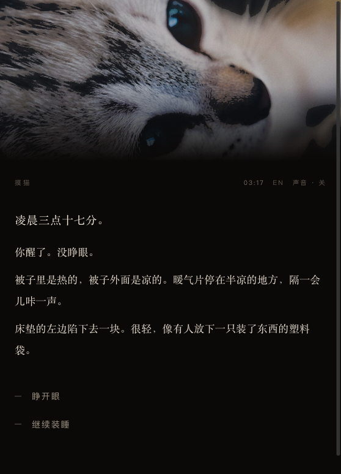
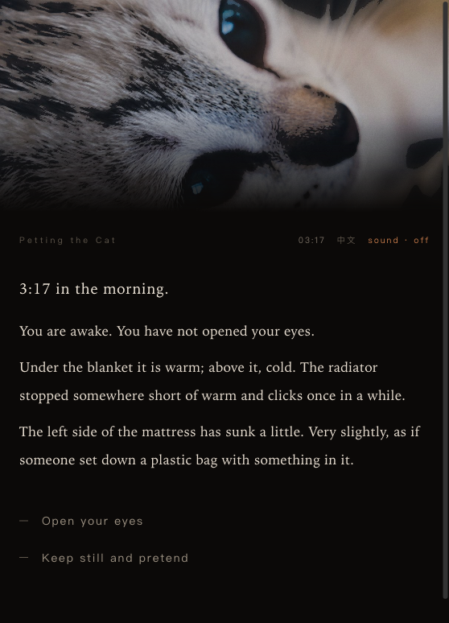

# 摸猫 · Cat Petting

凌晨 03:17 醒来，床边有一只猫。你只有一个动作：摸它。到 05:40 结束。

一个用 Twine 2 / SugarCube 2.37.3 写成的短篇文字冒险。单文件 HTML，双击即玩，中英双语随时切换，不需要联网，也不需要安装任何东西。

中文 · 英文 | 03:17 — 05:40 | 大约三分钟

**在线试玩：<https://wangxinyi1014.github.io/cat-petting/>**（手机也能开）

Play in the browser: <https://wangxinyi1014.github.io/cat-petting/>




## 怎么玩

- 打开 `摸猫.html`（双击，或者拖进浏览器）。整个游戏就是这一个文件。
- 页眉右边是语言开关 `EN / 中文`，点一下整页换语言，当前进度、时间、摸了几下都不会丢。
- 选项就是正文下面的那几行字。摸下去，时间会走；不摸，时间也会走。
- 页眉里的「声音」是猫的呼噜声，浏览器本地合成，不含任何音频文件。

## 在 Twine 2 里改它

这个文件是 Twine 的正式导出件，可以原样导回编辑器逐段改文字。

1. 打开 Twine 2（<https://twinery.com>）→ Library → Import → 选 `摸猫.html`。
2. 故事格式是 SugarCube 2.37.3，共 20 个段落：`Start`、`装睡`、`装睡二`、`床`、`看它`、`十厘米`、`第一次`、`页眉`、`动作`、`摸头顶`、`挠下巴`、`摸背`、`摸肚子`、`看它二`、`停手`、`走`、`睡着`、`天亮`、`收手`、`厨房`。
3. 每个段落里，中文和英文并排写在 `<div class="lang-zh">` 与 `<div class="lang-en">` 里。只改里面的句子、不动 `<div>` 和 `<<…>>`，就不会坏。
4. 改完 Story → Publish to File，导出仍然是单文件 HTML。

写作时的几个约定：

- 一次抚摸 `$t` 加一；`$pets` 是页眉时钟的索引，13 个刻度从 03:17 走到 05:40，数组写在 `Start` 里。
- `$t gte 7` 才会出现「摸肚子」；`$t gte 10` 之后只剩「……」，下一步就是睡着。
- 连续两次收手、而且摸不到 4 下，它会走。
- 三个结局：`睡着`、`走`、`十厘米`（手一直没有伸出去）。

## 从源码重新编译

```bash
python3 build_twine.py      # 生成 摸猫.html
```

只用到 Python 标准库。脚本需要 SugarCube 官方的故事格式文件 `format.js`，从下面这个 release 下载 zip 解压后放到 `format/sugarcube-2.37.3/format.js`：

<https://github.com/tmedwards/sugarcube-2/releases/download/v2.37.3/sugarcube-2.37.3-for-twine-2.1-local.zip>

脚本用这个文件里的 `source` 模板拼出 HTML，产物与 Twine 自己的「Publish to File」同构。图片在 `assets/` 里，编译时直接读进来做 base64 内嵌，所以交付物永远是单个文件。

## English

A short text adventure. You wake at 03:17. There is a cat beside the bed. You have exactly one action: pet it. It ends at 05:40. About three minutes.

Built with Twine 2 / SugarCube 2.37.3 and exported as a single HTML file — double-click to play, no install, no network. The `EN / 中文` link in the page header switches language in place; progress and clock are preserved.

To edit: import `摸猫.html` into Twine 2 (Library → Import). Both languages sit side by side in every passage, inside `<div class="lang-zh">` and `<div class="lang-en">`. Change the sentences, keep the divs and the `<<…>>` macros, then publish to file again.

Rebuild with `python3 build_twine.py` (standard library only; needs SugarCube's `format.js`, link above).

## 出处 / Credits

- 形式上致敬 neongrey 的 [Cat Petting Simulator 2014](https://neongrey.itch.io/pet-that-cat)：一个动作，一句一句地写，几分钟。
- 照片：Erik Knoef（Petselfie），Unsplash。
- 文字、代码：本仓库作者。
